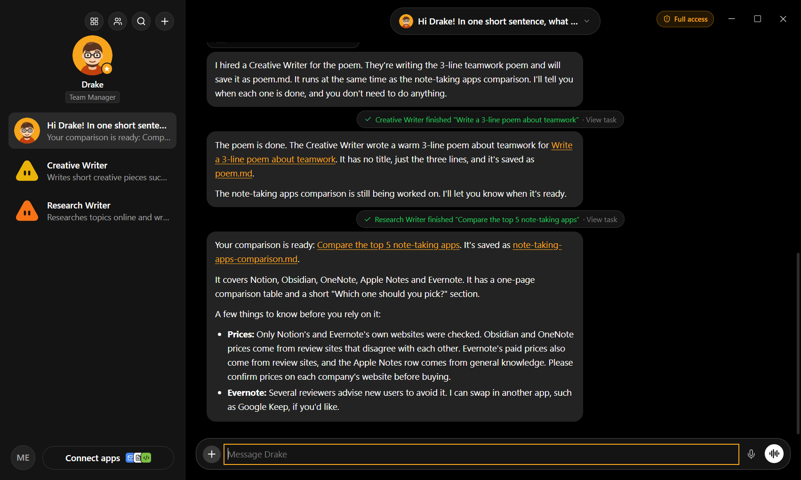
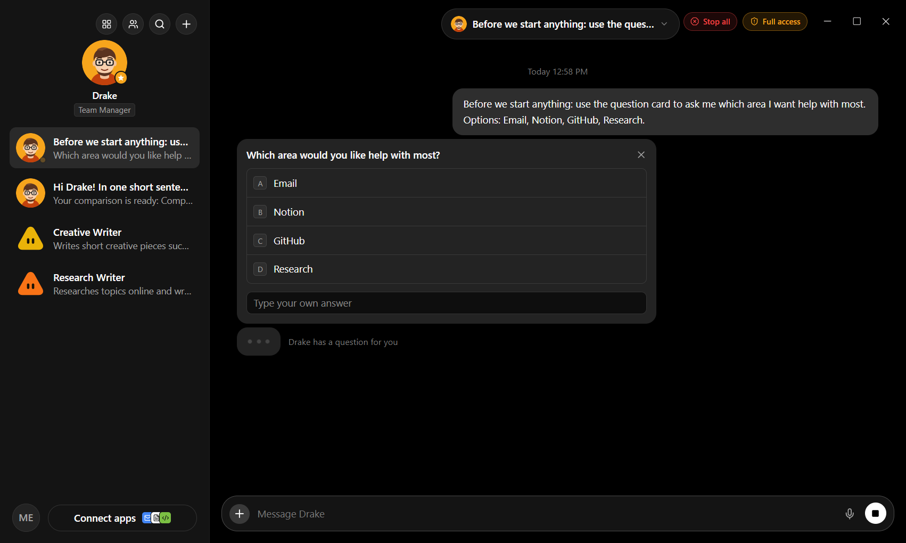
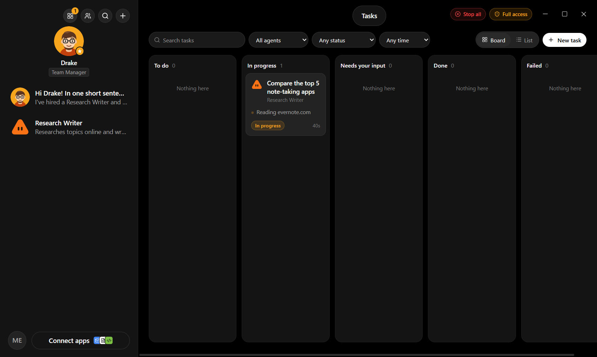
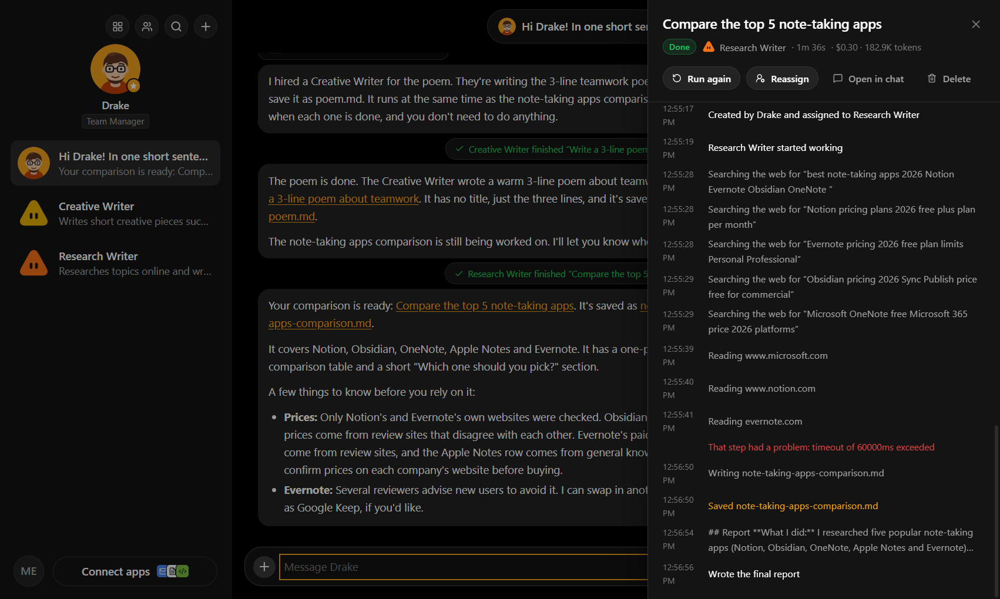
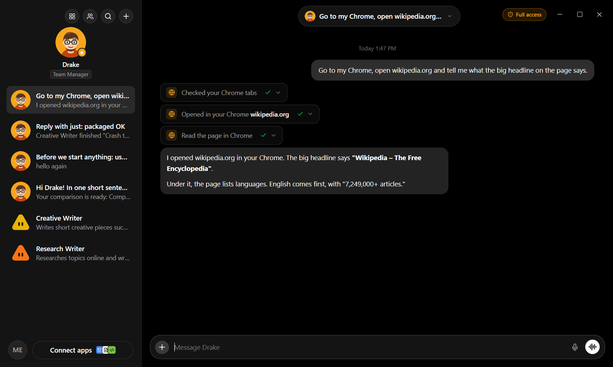

<p align="center">
  
</p>

<h1 align="center">agentCloud</h1>

<p align="center">
  A friendly desktop app that puts a chat interface on top of <b>Claude Code</b>.<br/>
  You talk to one <b>Manager</b>. The Manager hires specialist <b>Agents</b>, gives them <b>Tasks</b>,<br/>
  the agents do the work on your computer, and the Manager reports back in plain language.
</p>

<p align="center">
  Windows-first · also runs on macOS and Linux · built for non-technical users
</p>

---



## What it does

- **One person to talk to.** You chat with your Manager (default name “Drake”). Change the name, look, role and personality any time.
- **Small jobs, done on the spot.** Quick searches, looking something up, reading a file, moving files or a few clicks in your browser: the Manager does these itself.
- **Bigger jobs: asks, then hires.** For real work (reports, research, blog posts, spreadsheets, code), the Manager first asks you 1–3 short questions. Then it picks or hires the right agent, gives it the right **skills** from the ones installed on your computer, and starts the task.
- **Agents work in parallel, in the background.** Keep chatting while several tasks run. Each task has a live activity log, a list of changed files and a final report.
- **Reports with links.** When a task finishes, the Manager tells you what was done and links straight to the task and the files.
- **Uses your own Chrome.** Through the *Claude in Chrome* extension, agents can click, type and read pages in your real Chrome, where you're already logged in.
- **Question cards.** When an agent needs a decision, you get a card with options A–D (or type your own answer). Keyboard shortcuts work too.
- **Plain language everywhere.** “Team” not “subagents”, “Connections” not “MCP servers”, and errors that explain what happened and what to do next.

| Question card | Task board | Task details |
|---|---|---|
|  |  |  |



## Features

**Chat**
- Streaming replies with Markdown, code blocks (with copy button) and tables
- Tool activity shown as small, plain-language cards (“Created report.md”, “Searched the web for…”) that expand to show details
- Attach files with **+** or drag-and-drop (copied into your workspace)
- Voice dictation where the system supports it

**Team**
- Agent editor in plain words: name, role, “What should this agent do?”, abilities as checkboxes, model (*Smartest / Balanced / Fastest*), connections and skills
- Templates: Researcher, Writer, Coder, Email Assistant, Data Analyst, Designer
- Import and export agents as Claude Code agent `.md` files, so they also work in the Claude Code CLI

**Tasks**
- Board view (To do → In progress → Needs your input → Done → Failed) and a list view
- Drag a card to *In progress* to start it
- Cancel, retry, resume, reassign, or “Ask Manager to fix” a failed task
- Filters by agent, status and date, plus search

**Settings**
- **Connections** (MCP servers): a gallery of common apps plus an advanced mode, with *Test connection*. It reads and writes the same config as Claude Code (user and project scope).
- **Skills**: list, enable/disable, add from a folder or `.zip`, delete
- **Plugins**: list, enable/disable, install from a folder or marketplace, remove
- **Permissions**: *Full access* or *Ask before risky actions*, plus allowed and blocked command lists
- **Account & usage**: sign-in status, API key, and cost/tokens per day, agent and task
- **Telegram** (message channel): talk to the Manager from your phone through your own bot, with pairing-code security. *Built but not yet tested end to end; see Status below.*

**Safety**
- A clear **Full access** badge, a **Stop all** button and **Ctrl+Shift+X** to stop every agent at once
- All agent work happens inside a **workspace folder** you choose
- API keys and bot tokens are stored encrypted with Electron `safeStorage`
- Crash recovery: interrupted tasks are marked *Interrupted* and can be resumed where they left off

## Getting started (users)

1. Download and run `agentCloud-Setup-<version>.exe` (from Releases, or build it yourself, see below).
2. Follow the 4-step welcome:
   1. Welcome
   2. **Connect to Claude**: sign in with your Claude account (Pro/Max) or paste an API key
   3. **Choose a workspace folder**, where your agents save their work
   4. **Meet your Manager**: pick a name and a look
3. Say what you need, for example: *“Research the top 5 note-taking apps and write a comparison in my workspace.”*

To let agents use your Chrome, install the **Claude** extension for Chrome and sign in once (Settings → Connections shows whether it's ready).

> The installer isn't code-signed yet, so Windows SmartScreen may warn the first time. Click **More info → Run anyway**.

## Development

**Requirements:** Node.js 22+ and npm. On Windows, use Git Bash or PowerShell.

```bash
npm install          # also downloads Electron and the Claude Code engine
npm run dev          # start the app with hot reload
npm run typecheck    # type-check main + renderer
npm run build        # production build into out/
npm run dist         # build the Windows installer into dist/
```

If Electron didn't download during install, run `node node_modules/electron/install.js`.

### Tech stack

- **Electron** + **React 19** + **TypeScript** + **Vite** (`electron-vite`)
- **Tailwind CSS v4** (theme tokens in CSS variables), **Framer Motion**, **Lucide** icons
- **Zustand** for UI state
- **SQLite** via `better-sqlite3` for agents, chats, tasks, usage and settings (migrations run on startup)
- **Claude Agent SDK** (`@anthropic-ai/claude-agent-sdk`) in the Electron **main process** only. The renderer talks to it through a typed `contextBridge` API (`contextIsolation: true`, `nodeIntegration: false`).
- **electron-builder** for the installer

### How it works

```
Renderer (React UI)
   │  typed IPC (shared/api.ts)
   ▼
Main process
   ├─ ChatSession (claude/manager.ts)    long-lived SDK session per chat (Manager or a direct agent chat)
   ├─ App tools (claude/appTools.ts)     in-process MCP tools: hire_agent, find_skills, list_agents, fire_agent,
   │                                     create_task, start_task, cancel_task, get_task_status, ask_user, notify_user
   ├─ Task runner (claude/agentRunner.ts) one SDK query() per task, running in parallel; reports go back to the Manager
   ├─ Config (claude/config.ts)          MCP servers, skills, plugins, agent .md files, shared with Claude Code
   ├─ Telegram channel (telegram.ts)     optional phone channel
   └─ SQLite (db/)                       agents, conversations, messages, tasks, task_events, usage, settings
```

- In **Full access** mode, sessions run with the SDK's bypass-permissions mode. In **Ask** mode, risky actions show *Allow / Deny* cards.
- Chrome control uses Claude Code's `--chrome` integration (*Claude in Chrome* extension). Playwright is turned off for those sessions so agents don't open a separate, empty browser.
- Model labels map to Claude aliases: Smartest → `opus`, Balanced → `sonnet`, Fastest → `haiku`.

### Project structure

```
electron/
  main.ts              window, IPC handlers, lifecycle, crash safety
  preload.ts           typed contextBridge API
  telegram.ts          Telegram message channel
  claude/
    sdk.ts             SDK loader, auth check, permissions, Chrome options, friendly errors
    manager.ts         Manager + agent chat sessions, system prompts
    agentRunner.ts     runs tasks as separate SDK sessions
    appTools.ts        in-process MCP tools for the Manager and agents
    interactions.ts    questions and permission requests waiting on the user
    config.ts          MCP / skills / plugins / agent-file config
  db/                  SQLite schema, migrations, repositories
shared/                types and IPC contract shared by main and renderer
src/
  app/                 screens: Chat, Tasks, Team, Settings, Onboarding, overlays
  components/          Sidebar, chat items, Composer, TaskDrawer, UI primitives
  stores/              Zustand store
  lib/                 IPC client, formatting, tool labels
resources/             app icon
scripts/               icon generator, test driver (cdp.mjs)
```

### Testing tips

Run the app with a throwaway profile and drive it from a script:

```bash
npm run build
AGENTCLOUD_USER_DATA=/tmp/ac-profile AGENTCLOUD_DEFAULT_WORKSPACE=/tmp/ac-ws \
  node_modules/electron/dist/electron.exe . --remote-debugging-port=9333
node scripts/cdp.mjs 9333 shot screen.png
node scripts/cdp.mjs 9333 eval "window.agentCloud.tasksList()"
```

`AGENTCLOUD_TELEGRAM_API` can point the Telegram channel at a local fake server.

## Status

Tested end to end on Windows 11 with a Claude Pro account:
onboarding, Manager chat, asking questions before hiring, hiring with skills, parallel tasks with reports and file links, Question cards (mouse and keyboard),
Stop all / cancel, Chrome control, offline queueing, missing-workspace recovery, crash recovery with resume, and the packaged installer.

Not yet verified:
- **Telegram channel**: code complete, not yet tested with a real bot.
- The “Claude is busy” automatic retry: built, but no real rate limit was hit during testing.
- Light theme, macOS and Linux builds.
- Code signing for the installer.

## Contributing

Contributions are welcome! Read [CONTRIBUTING.md](CONTRIBUTING.md) to get started, and please follow the [Code of Conduct](CODE_OF_CONDUCT.md).
Found a security problem? See [SECURITY.md](SECURITY.md).

## License

[MIT](LICENSE)
